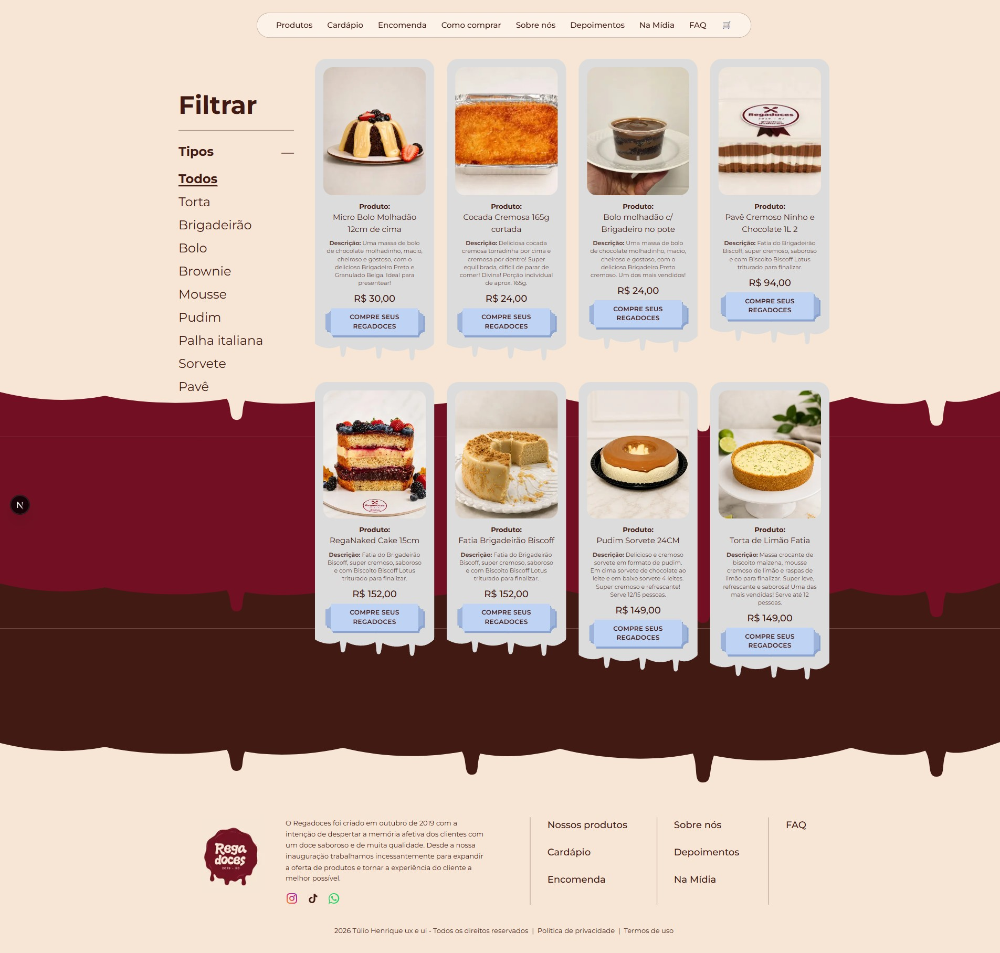
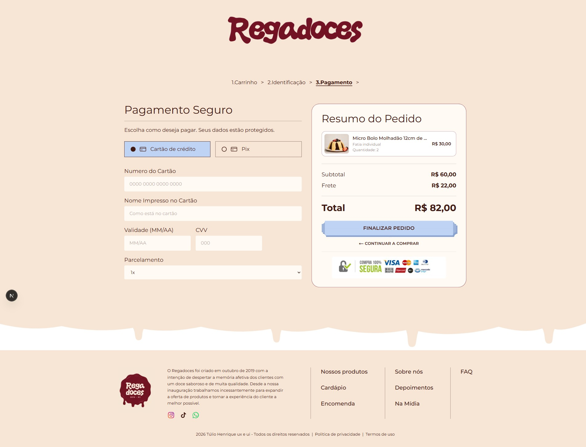
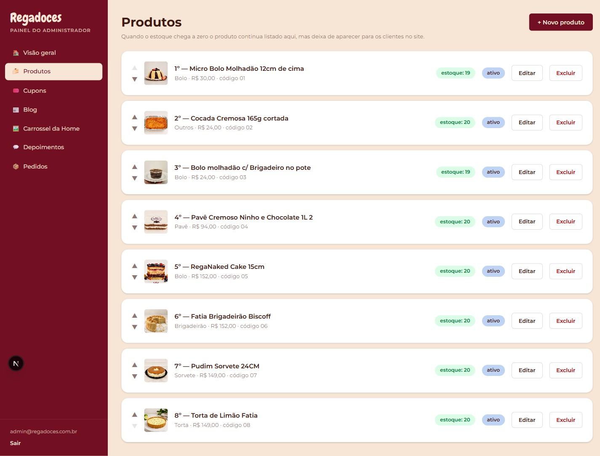

# Regadoces — loja online + painel administrativo

E-commerce completo de uma doceria (Regadoces, RJ), construído do zero a partir das LPs do designer:
catálogo com mais de 120 produtos e filtro por categoria, carrinho, checkout em 3 passos, pagamento por
**Pix** (QR code + copia e cola, confirmação automática por webhook) e **cartão de crédito/débito**
(link de pagamento), ambos via **C6 Bank**, cupons de desconto, blog "Na Mídia", depoimentos com
moderação e um **painel administrativo** completo. Tudo em Next.js, publicado em hospedagem cPanel com Node.js.

🔗 **Site em produção:** https://regadoces.com.br

| Home | Cardápio | Pagamento | Painel |
|---|---|---|---|
|  |  |  |  |

## Stack

- **Next.js 16** (App Router, Server Components, Route Handlers, middleware) · **React 19** · **TypeScript**
- **Tailwind CSS v4** — identidade visual fiel às LPs (Montserrat + Chewy, caldas "derretidas" em CSS mask a partir do SVG oficial do designer)
- **Supabase** (Postgres + Storage) para dados e fotos enviadas pelo painel, com fallback em JSON local para desenvolvimento
- **C6 Bank** — OAuth2 client_credentials com **mTLS**: API Pix (cobrança imediata, consulta, webhook) e API de Checkout (link de pagamento para cartão)
- Autenticação do painel com **bcrypt** + **JWT** (jose) em cookie httpOnly, sessão renovada automaticamente pelo middleware; validação de entrada com **zod**
- Notificação de venda no celular via **ntfy** e exportação de pedidos em CSV
- Deploy em **cPanel / Passenger (Node 22)** pela API do cPanel (build `standalone` gerado localmente)

## Funcionalidades

**Loja**
- Home com carrossel gerenciável, categorias, cardápio, encomendas, como comprar, depoimentos, blog e FAQ
- `/produtos` e `/produtos/<categoria>` — URLs limpas; estoque zero oculta o produto do site
- Carrinho persistido no navegador, cupom de desconto, cálculo de frete por faixa de CEP ou retirada
- Checkout: identificação (com busca de CEP), Pix ou cartão, página do pedido com QR code e status ao vivo
- Loja "aberta/fechada" estilo iFood (o carrinho fica salvo até reabrir) e botão flutuante de WhatsApp

**Painel** (`/painel`)
- Produtos (nome, foto, descrição, preço e preço promocional, categoria, ordem por arrastar-e-soltar, estoque, ativo), busca e filtro
- Categorias, carrossel da Home, encomendas, "Sobre nós" e FAQ editáveis
- Cupons: percentual ou valor fixo, validade, limite de usos e opção **1 uso por CPF**
- Blog, moderação de depoimentos, pedidos (status, forma de pagamento, CSV), tabela de frete, loja aberta/fechada

**Segurança**
- Preço, estoque e desconto sempre recalculados no servidor: o carrinho do navegador nunca é fonte de verdade
- O site nunca recebe dados de cartão: o cliente digita na página segura do banco
- Painel fora do índice dos buscadores, rate limit no login, cabeçalhos de segurança no middleware

## Rodando localmente

```bash
npm install
cp .env.example .env.local   # ajuste ADMIN_SLUG e SESSION_SECRET
npm run dev                  # http://localhost:3000
```

Sem chaves do Supabase/C6 o projeto roda em **modo local**: dados em `data/*.json` e pagamento simulado.
O admin inicial deste repositório é `admin@regadoces.com.br` / `trocar-esta-senha` (troque o hash em `data/admins.json`).

## Deploy (cPanel + Node.js)

`scripts/deploy-nuvem.sh` gera o build standalone, envia pela API do cPanel, extrai e reinicia a aplicação Passenger.
Nunca sobrescreve os dados do servidor. Usuário, host e pasta da aplicação vêm de variáveis de ambiente
(`CPANEL_USER`, `CPANEL_HOST`, `CPANEL_APP_DIR`) e o token de API fica em `~/.regadoces-cpanel-token`.

## Integração C6 Bank

- `src/lib/c6bank.ts` — token, cobrança Pix, consulta, webhook, link de pagamento (mTLS com certificado PEM)
- `scripts/c6-evidencias*.mjs` e `scripts/preencher-roteiro-c6.mjs` — geram as evidências no sandbox e preenchem o roteiro de homologação do C6 automaticamente
- `scripts/c6-webhook*.mjs` — cadastram e consultam o webhook das chaves Pix e Checkout

---

Design: Túlio Henrique (UX/UI) · Desenvolvimento: [Hiro](https://github.com/HiroDev-lab)
